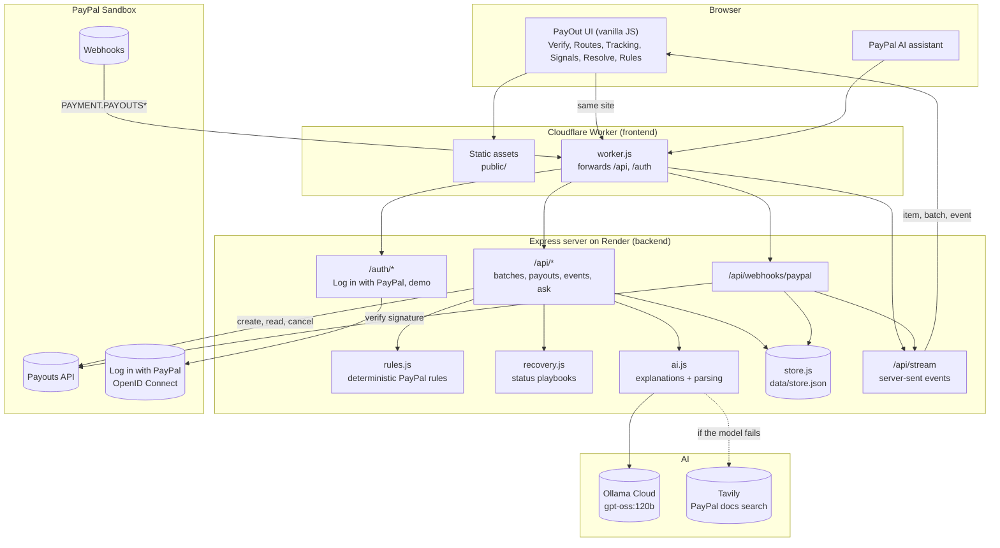
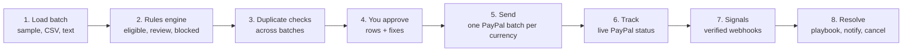
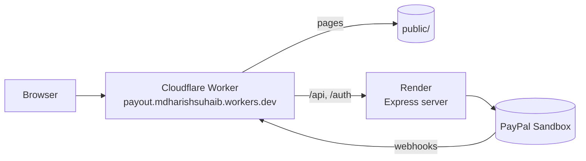

<div align="center">
<br/>


**PayOut: PayPal's Payout platform that validates every payout**

*Every payout, checked before money moves.*

**Live:** [payout.mdharishsuhaib.workers.dev](https://payout.mdharishsuhaib.workers.dev)

[](https://github.com/mdharishsuhaib/PayOut/stargazers) [](https://github.com/mdharishsuhaib/PayOut/network/members)

[](https://nodejs.org/) [](https://expressjs.com/) [](https://developer.mozilla.org/docs/Web/JavaScript) [](https://developer.paypal.com/docs/payouts/) [-000000?style=flat-square&logo=ollama&logoColor=white)](https://ollama.com/) [](https://workers.cloudflare.com/) [](https://render.com/)
</div>

---

## About the Project

*Pay + out: everything that happens to money after you press "send".*

PayOut is an AI-powered payout intelligence platform built on the **PayPal Payouts REST API**
for businesses that pay many people at once: **freelancers, contractors, creators, sellers and
gig workers**, at home or across borders.

A payout batch can fail in ways nobody sees until the money is already gone: a country that
cannot send, a currency that is in-country only, a yen amount with decimals, a duplicate row, a
person paid twice, an email with no PayPal account. PayOut checks every row against PayPal's
own published country and currency rules **before** anything is sent, sends only the rows you
approve through the real PayPal Payouts API, then follows each payout with PayPal's live status
and webhooks, and tells you exactly what to do when one is unclaimed, held, blocked, failed or
returned.

---

## Try It Now (for Judges)

No install and no PayPal account needed:

1. Open **[payout.mdharishsuhaib.workers.dev](https://payout.mdharishsuhaib.workers.dev)**. The
   server runs on Render's free plan, so the first visit after a quiet spell can take up to a
   minute while it wakes.
2. Click **Login**, then **Try the demo**.
3. On **Verify**, click **Sample**: 11 contractors in 9 countries are checked against PayPal's
   rules. Click any row to see why it is ready, needs review or is restricted, and the AI's
   explanation.
4. Approve the rows you want and press **Send**. They go to the real PayPal Sandbox Payouts API.
   Follow them in **Tracking**, **Signals** (verified PayPal webhooks) and **Resolve**.
5. Try **Routes** (any sender country → recipient country → currency) and the floating
   **PayPal AI** button.

To use your own PayPal Sandbox account instead, click **Log in with PayPal** and sign in with a
Sandbox **personal** account from developer.paypal.com (**Testing Tools > Sandbox Accounts**).
To run it yourself, see [Quick Start](#quick-start).

---

## Table of Contents

- [Try It Now (for Judges)](#try-it-now-for-judges)
- [Overview](#overview)
- [Key Features](#key-features)
- [System Architecture](#system-architecture)
- [Repository Structure](#repository-structure)
- [Prerequisites](#prerequisites)
- [Quick Start](#quick-start)
- [Backend Setup](#backend-setup)
- [Frontend Setup](#frontend-setup)
- [API Reference](#api-reference)
- [Database Schema](#database-schema)
- [Security and Privacy Model](#security-and-privacy-model)
- [Operational Limits and Constraints](#operational-limits-and-constraints)
- [Deployment](#deployment)
- [Running Tests](#running-tests)
- [Troubleshooting](#troubleshooting)
- [Learning Guide](#learning-guide)
- [AI Tools Used](#ai-tools-used)
- [Tech Stack](#tech-stack)
- [License](#license)

---

## Overview

1. A customer opens PayOut and signs in with **Log in with PayPal** (PayPal Sandbox), or
   creates a PayPal business account through **Sign Up**. Judges can use **Try the demo** on the
   Login and Sign Up pages, with no PayPal account needed.
2. **Verify:** they load a payout batch: the **sample** (11 contractors in 9 countries), a **CSV
   upload**, or **pasted text** such as `Priya priya@studio.in 200 USD India`. Pasted text is
   turned into rows by the AI, with a rules-based parser as backup.
3. **Rules engine:** deterministic code checks every row against PayPal's published country
   feature list (93 countries), the 25 REST API currencies, conversion exclusions, in-country-only
   currencies, zero-decimal currencies, recipient format and duplicates. Each row becomes
   **eligible**, **review** or **blocked**, and every finding links to the PayPal page it comes from.
4. **No double payments:** a reference already sent from another batch is **blocked**
   (`ALREADY_PAID`); the same receiver, amount and currency paid before needs **review**
   (`PAID_BEFORE`).
5. **AI explanation:** for any row, the AI explains the findings in plain words and suggests a
   fix. It never decides eligibility; it only reads the rules engine's results.
6. **Send:** only approved rows go to PayPal with `POST /v1/payments/payouts`, split into one
   PayPal batch per currency (PayPal rejects mixed currencies), with an idempotent request ID.
7. **Tracking:** every payout sent, with the live status PayPal reports
   (`GET /v1/payments/payouts/{id}` and `/payouts-item/{id}`), fees and transaction IDs.
8. **Signals:** PayPal webhooks (`PAYMENT.PAYOUTS-ITEM.*`, `PAYMENT.PAYOUTSBATCH.*`) are
   signature-verified with `POST /v1/notifications/verify-webhook-signature`, processed once, and
   pushed live to the screen.
9. **Resolve:** every payout that needs attention, most urgent first, with a 30-day countdown for
   unclaimed payouts, a playbook for each status, and a one-click **cancel** for unclaimed ones
   (`POST /v1/payments/payouts-item/{id}/cancel`), re-checked with PayPal first.
10. **Routes and Rules:** check any sender country, recipient country and currency before you
    pay, and browse PayPal's country and currency rules. **PayPal AI** answers payout questions
    about the screen you are on.

---

## Key Features

- **Rules decide, AI explains** -- Eligibility comes only from deterministic rules transcribed
  from PayPal's documentation, each with its source link. The AI rewords and explains; it cannot
  approve a row.
- **Checked before money moves** -- Sending country (91 of 93 can send), recipient country,
  currency support, in-country-only currencies (for example INR), zero-decimal currencies (JPY,
  HUF, TWD), conversion exclusions, Venmo US-only, malformed emails or phones, batch size limits.
- **One-click fixes** -- "Pay in USD instead", "Round to 25001" and similar fixes edit the row and
  re-run the checks instantly.
- **Never pay twice** -- Duplicates inside a batch, references already paid in another batch,
  and repeat payments to the same person are caught across all of the customer's batches.
- **Real PayPal Payouts** -- Batches go to the PayPal Sandbox through the Payouts API, split per
  currency, and the real status comes back from PayPal.
- **Verified webhooks** -- Signatures are verified with PayPal. Unverified events are never
  trusted: they only trigger a fresh status read from the PayPal API.
- **Recovery playbooks** -- Unclaimed, on hold, blocked, failed, returned, refunded, reversed and
  denied, each with what it means, what is safe to do next and PayPal's error hint.
- **Cancel unclaimed payouts** -- Get the money back before the 30-day automatic return, after
  PayPal confirms the item is still unclaimed.
- **Context-aware PayPal AI** -- A movable PayPal button opens an assistant that knows which row,
  payout or route is on screen, answers "which payouts need my attention today?" from real
  PayPal data, and falls back to a Tavily search of PayPal's own docs when the model is down.
- **Customer accounts kept apart** -- Every batch, payout and event belongs to one PayPal
  account; customers only ever see their own.
- **Live updates** -- Server-sent events refresh Tracking, Signals and Resolve the moment PayPal
  reports a change.
- **Built for every screen** -- A resizable sidebar (drag its edge), a drawer on tablets and
  phones, and layouts checked at phone, tablet, laptop, desktop and monitor sizes.

---

## System Architecture



- **Frontend** -- Plain HTML, CSS and ES modules (no build step) with AG Grid for the batch
  table. Served by a Cloudflare Worker, which forwards `/api` and `/auth` to the
  backend, so the browser only ever talks to one site.
- **Backend** -- Node.js 22 + Express 4 on Render. Holds the PayPal client secret, the rules
  engine, the AI calls and the data store.
- **PayPal** -- Payouts API (create, get batch, get item, cancel item), webhook signature
  verification, and Log in with PayPal (OpenID Connect), all on the PayPal Sandbox.
- **AI** -- `gpt-oss:120b` on Ollama Cloud through an OpenAI-compatible endpoint. If it fails,
  answers come from a Tavily search limited to PayPal's own sites, then from built-in templates.

### Project Pipeline



| # | Step | What happens | Engine | Output |
|---|---|---|---|---|
| 1 | Load batch | Sample, CSV (headers mapped automatically) or pasted text | `csv.js`; pasted text: AI, then rules-based parser | Rows |
| 2 | Rules engine | Route, currency, recipient and amount checks for every row | `rules.js` (no model) | Findings with PayPal source links, decision per row |
| 3 | Duplicate checks | Same reference or same person + amount + currency in this or another batch | `server.js` `evaluate()` | `ALREADY_PAID` (block), `PAID_BEFORE` (review) |
| 4 | Approve | Eligible rows are approved; review rows need a tick; blocked rows cannot be sent | Customer | Approved rows |
| 5 | Send | Re-checks, then `POST /v1/payments/payouts` per currency | PayPal Payouts API | PayPal batch IDs |
| 6 | Track | `GET /v1/payments/payouts/{id}` fills item IDs, statuses and fees | PayPal Payouts API | Tracking list |
| 7 | Signals | Webhook received, signature verified, matched to the payout, processed once | PayPal webhooks | Event history, live update |
| 8 | Resolve | Fresh status read, playbook, AI note, cancel if unclaimed | `recovery.js`, `ai.js`, PayPal | Next action |

**When something fails:**

- No PayPal keys: the app runs in a clearly labelled simulation instead of calling PayPal.
- AI down or no key: explanations come from the Tavily PayPal-docs search, then templates.
- Unverified webhook: its body is not trusted; the status is read again from the PayPal API.
- PayPal rejects one currency batch: the others still go through, and the rejection is recorded.

---

## Repository Structure

```text
PayOut/
├── server.js                    # Express app: auth, API routes, webhooks, live updates
├── lib/
│   ├── env.js                   # Loads .env (drops inherited OPENAI_* variables)
│   ├── rules.js                 # PayPal country and currency rules, preflight, route checks
│   ├── recovery.js              # Status playbooks, PayPal error hints, webhook event map
│   ├── paypal.js                # Payouts API client: token, create, get, cancel, verify webhook
│   ├── login.js                 # Log in with PayPal (OpenID Connect) and sessions
│   ├── ai.js                    # Ollama Cloud model, Tavily PayPal-docs fallback, text parsing
│   ├── faq.js                   # Grounded answers for common payout questions
│   ├── csv.js                   # CSV parser and header mapping
│   └── store.js                 # JSON store, scoped to each customer account
├── public/
│   ├── index.html               # App shell: sidebar, header, footer, PayPal AI panel
│   ├── app.js                   # Router, sidebar (resize + collapse), auth, live updates
│   ├── util.js, list.js, grid.js, inspect.js, thread.js
│   ├── views/                   # home, auth, preflight (Verify), routes, payouts (Tracking),
│   │                            # signals, resolve, rules
│   ├── *.css                    # app, sidebar, home, pages, screens-a..d, thread, views
│   ├── vendor/                  # AG Grid table library (loaded on Verify only)
│   └── payout-logo.svg, paypal-logo.svg, paypal-mark.svg, paypal-wordmark-white.svg
├── data/
│   └── sample.csv               # 11 synthetic contractors in 9 countries
├── worker.js                    # Cloudflare Worker: serves public/, forwards /api and /auth to Render
├── wrangler.jsonc               # Cloudflare Worker settings: name, assets, BACKEND_URL
├── test/
│   ├── rules.test.js            # Unit tests for the rules engine (npm test)
│   ├── e2e.mjs                  # Full run against the real PayPal Sandbox
│   └── responsive.mjs           # Every page at phone to monitor sizes
├── render.yaml                  # Render blueprint for the backend
├── .env.example                 # Every setting documented (no values)
├── package.json
├── LICENSE                      # MIT
└── README.md
```

---

## Prerequisites

- **Node.js 22+** and `npm`.
- A free [PayPal Developer](https://developer.paypal.com) account with a **Sandbox app**
  (client ID and secret) that has **Payouts** and **Log in with PayPal** enabled, and a Sandbox
  business account with balance (US is used by default).
- Recommended: an [Ollama](https://ollama.com/settings/keys) API key for the AI, and a
  [Tavily](https://app.tavily.com) key as the AI fallback. Without them, PayOut still runs and
  uses templates for explanations.
- For deployment: a free [Cloudflare](https://dash.cloudflare.com) account, a free
  [Render](https://render.com) account and a GitHub repository.

---

## Quick Start

One process, one terminal (Windows PowerShell shown).

```powershell
cd C:\path\to\PayOut
npm install
copy .env.example .env
# Open .env and fill in PAYPAL_CLIENT_ID, PAYPAL_CLIENT_SECRET, AI_API_KEY, TAVILY_API_KEY
npm start
```

Open:

- App: `http://localhost:3100`
- Health: `http://localhost:3100/healthz`
- PayPal, AI and webhook status: `http://localhost:3100/api/config`

Click **Login**, then **Try the demo** (or **Login with PayPal** with a Sandbox personal or
business account). In **Verify**, click **Sample**, review the findings, approve rows and press
**Send to PayPal**. Then open **Tracking**, **Signals** and **Resolve**.

On macOS or Linux, use `cp` instead of `copy`. For auto-reload while editing, use `npm run dev`.

---

## Backend Setup

The backend is `server.js` with the modules in `lib/`. Locally it also serves the frontend from
`public/`, so one process runs everything.

**Settings.** Add to `.env` in the project root (git-ignored; every setting is described in
`.env.example`):

```env
PAYPAL_CLIENT_ID=your-sandbox-client-id
PAYPAL_CLIENT_SECRET=your-sandbox-secret
PAYPAL_API_BASE=https://api-m.sandbox.paypal.com
PAYPAL_WEBHOOK_ID=
SENDER_COUNTRY=US
SANDBOX_RECEIVER_EMAIL=sb-xxxx@personal.example.com
AI_API_KEY=your-ollama-key
TAVILY_API_KEY=your-tavily-key
PORT=3100
```

**All settings:**

| Variable | Required | Purpose |
|---|---|---|
| `PAYPAL_CLIENT_ID`, `PAYPAL_CLIENT_SECRET` | Yes (else simulation) | Sandbox app credentials, used for Payouts and Log in with PayPal |
| `PAYPAL_API_BASE` | No | Defaults to `https://api-m.sandbox.paypal.com` |
| `PAYPAL_RETURN_URL` | Deployed: yes | Log in with PayPal return URL, e.g. `https://<site>/auth/paypal/callback`. Must also be added to the app on developer.paypal.com |
| `PAYPAL_WEBHOOK_ID` | Recommended | Webhook ID from developer.paypal.com; turns on signature verification |
| `PAYPAL_LIVE_LOGIN` | No | Login stays on the Sandbox unless this is `1` |
| `SENDER_COUNTRY` | No | Country of the sending business account (default `US`; must be a sending country) |
| `SANDBOX_RECEIVER_EMAIL` | Recommended | A Sandbox personal account, so one sample payout really succeeds |
| `SANDBOX_RECEIVER_IN_EMAIL` | No | A Sandbox personal account in India for the sample's Indian row |
| `AI_API_KEY` | Recommended | Ollama Cloud API key |
| `AI_BASE_URL`, `AI_MODEL` | No | Default `https://ollama.com/v1` and `gpt-oss:120b` (any OpenAI-compatible endpoint works) |
| `TAVILY_API_KEY` | Recommended | Fallback answers from PayPal's own docs |
| `REVIEW_AMOUNT` | No | USD payouts at or above this need review (default `2500`; a PayOut safety check, not a PayPal rule) |
| `DEMO_LOGIN` | No | Set to `0` to turn off the judges' demo |
| `DATA_FILE` | No | Store location (default `data/store.json`) |
| `PORT` | No | Default `3100` |

Restart the server after any change to `.env`; it is read only at start-up.

---

## Frontend Setup

The frontend is plain HTML, CSS and JavaScript modules in `public/`. There is no build step.

- **Locally:** `npm start` serves it at `http://localhost:3100` together with the API.
- **Deployed:** the Cloudflare Worker (`worker.js`, `wrangler.jsonc`) serves `public/` and forwards `/api`,
  `/auth` and `/healthz` to the backend. Every call from the UI uses a relative path,
  so there is no backend URL or CORS to configure in the frontend.

To preview the Worker locally against your local backend:

```powershell
npx wrangler dev --port 8788 --var BACKEND_URL:http://localhost:3100
```

Then open `http://localhost:8788`.

---

## API Reference

Base URL: `http://localhost:3100` (local) or `https://payout.mdharishsuhaib.workers.dev`
(deployed). Endpoints marked **auth** need a signed-in session (the `pp_sid` cookie from Log in
with PayPal or the demo) and only return that customer's own data; otherwise they answer `401`.

### Authentication

| Method and path | Purpose |
|---|---|
| `GET /auth/paypal/login?next=preflight` | Redirects to PayPal's Sandbox login (OpenID Connect, scopes `openid profile email`) |
| `GET /auth/paypal/callback` | PayPal returns here with a one-time code; the server exchanges it and sets the session cookie |
| `POST /auth/demo` | Starts the judges' demo session. Body `{ "page": "login" }`; only accepted from PayOut's own Login or Sign Up page |
| `POST /auth/logout` | Ends the session |
| `GET /api/me` | Current user, whether login is configured, and the PayPal Sign Up link |

### Public

| Method and path | Purpose |
|---|---|
| `GET /healthz` | `ok` |
| `GET /api/config` | PayPal access check, AI model, sender country, rules version, `webhookVerification` |
| `GET /api/countries`, `GET /api/currencies` | PayPal's country feature list and currency rules |
| `POST /api/route/check` | Checks one route. Body `{ "from": "US", "to": "IN", "currency": "USD" }` |
| `POST /api/route/ask`, `POST /api/ask` | PayPal AI. Body `{ "question": "...", "context": { "batchId", "ref" } }` |
| `GET /api/ask/library` | Suggested questions by topic |
| `POST /api/webhooks/paypal` | PayPal webhook receiver (signature verified) |

### Batches and payouts (auth)

| Method and path | Purpose |
|---|---|
| `GET /api/batches` | The customer's batches with summaries |
| `GET /api/batches/:id` | One batch with every row, its findings and decision |
| `POST /api/batches/sample` | Creates the sample batch, or reopens it (`reopened: true`) |
| `POST /api/batches/csv` | Body: CSV text (`text/csv`) or `{ "csv": "...", "name": "..." }` |
| `POST /api/batches/text` | Body `{ "text": "Priya priya@studio.in 200 USD India" }` |
| `PATCH /api/batches/:id/rows/:ref` | Edit or approve a row; the checks run again |
| `GET /api/batches/:id/rows/:ref/explain` | AI explanation of a row's findings |
| `POST /api/batches/:id/submit` | Sends approved rows to PayPal, one batch per currency |
| `POST /api/batches/:id/sync` | Reads the latest status of every item from PayPal |
| `GET /api/batches/:id/rows/:ref/recovery` | Fresh PayPal status, playbook and AI note |
| `POST /api/batches/:id/rows/:ref/cancel` | Cancels an unclaimed payout. Body `{ "confirm": true }` |
| `POST /api/batches/:id/rows/:ref/demo-status` | Demo account only: a labelled practice status (`FAILED`, `BLOCKED`, `ONHOLD`, `UNCLAIMED`, `RETURNED`) |
| `GET /api/payouts` | Every payout the customer sent (Tracking, Resolve) |
| `GET /api/events?batch=` | Status changes and webhooks (Signals) |
| `GET /api/overview` | Counts, routes and payouts needing attention |
| `GET /api/stream` | Server-sent events: `item`, `batch`, `event` |

**Row finding:**

```json
{ "severity": "block", "code": "NO_DECIMALS", "title": "JPY has no decimals", "detail": "PayPal returns an error if a decimal amount is passed for JPY.", "source": "https://developer.paypal.com/api/rest/reference/currency-codes/", "fix": { "label": "Round to 25001", "patch": { "amount": "25001" } } }
```

`severity` is `pass`, `note`, `review` or `block`; a row's `decision` is `eligible`, `review`
or `blocked`.

**Example:**

```bash
curl -X POST http://localhost:3100/api/route/check -H "Content-Type: application/json" -d "{\"from\":\"US\",\"to\":\"IN\",\"currency\":\"INR\"}"
```

---

## Database Schema

PayOut keeps its data in **one JSON file** (`data/store.json`, git-ignored), written by
`lib/store.js`. Every record belongs to one customer: `pp:<PayPal user ID>` for a PayPal
login, or `demo` for the judges' demo. A Postgres database (for example Supabase) can replace it
without changing the API, but it is not needed to run PayOut.

| Store | Purpose and key fields |
|---|---|
| `batches[id]` | `id` (`B...`), `owner`, `name`, `source` (`sample`, `csv`, `text`, `ai`), `senderCountry`, `createdAt`, `rows`, `summary`, `batchFindings`, `payout`, `mapping` |
| `rows[]` (inside a batch) | `ref`, `name`, `receiver`, `recipientType` (`EMAIL`, `PHONE`, `PAYPAL_ID`), `wallet` (`PAYPAL`, `VENMO`), `country`, `currency`, `amount`, `findings`, `decision`, `approved`, `acknowledged`, `explanation`, `payout` |
| `rows[].payout` | `status`, `itemId`, `batchId`, `transactionId`, `fee`, `error`, `sentAt`, `updatedAt`, `demo` |
| `batches[id].payout` | `id`, `batches[]` (one per currency: `currency`, `id`, `status`, `count`, `fees`), `failures`, `status`, `simulated`, `submittedAt`, `syncedAt` |
| `events[]` | Up to 2,000: `id`, `at`, `owner`, `batchId`, `ref`, `type` (`ITEM.STATUS`, `BATCH.SUBMITTED`, `PAYMENT.PAYOUTS-ITEM.*`...), `source` (`paypal`, `webhook`, `simulated`, `demo`), `verified`, `steps`, `summary` |
| Server memory (not saved) | Sessions (8 hours), pending login states (10 minutes), live-update connections |
| Browser `localStorage` | Layout only: sidebar width and state (`payout.sideW`, `payout.side`), PayPal AI button position |

---

## Security and Privacy Model

- **PayPal password never seen.** Login happens on PayPal's own page; PayPal returns a one-time
  code that the server exchanges using the client secret, which never reaches the browser.
- **Sandbox only.** Login is locked to the PayPal Sandbox unless `PAYPAL_LIVE_LOGIN=1` is set on
  purpose. No real money moves.
- **HttpOnly session cookie.** A random session ID (`SameSite=Lax`, `Secure` on HTTPS); the
  profile stays on the server and expires after 8 hours.
- **Customers kept apart.** Every batch, payout and event is filtered by its owner; another
  customer's batch is treated as not found.
- **Webhooks are verified.** With `PAYPAL_WEBHOOK_ID` set, each event is checked with PayPal.
  A failed signature is rejected (`400`). An unverified event never changes a status by itself:
  it only triggers a fresh read from the PayPal API. Every event is processed once (PayPal
  retries up to 25 times).
- **Money moves only on approval.** Rows are re-checked right before sending; blocked rows can
  never be sent; review rows need an explicit tick; cancelling needs `{ "confirm": true }` and a
  live PayPal check that the item is still unclaimed.
- **Idempotent payouts.** Each PayPal request carries a `PayPal-Request-Id`, so a retry cannot
  create a second batch, and a submitted batch cannot be submitted again (`409`).
- **The AI cannot approve anything.** It only reads rule results and real PayPal statuses.
- **Demo is fenced.** The demo can only be started from PayOut's own Login and Sign Up pages, and
  practice statuses are clearly labelled and limited to the demo account.
- **Secrets stay out of git.** Keys live only in `.env` locally and as environment variables on
  Render. `.gitignore` excludes every `.env` variant, the data store, logs and Wrangler folders.

---

## Operational Limits and Constraints

| Constraint | Value | Where |
|---|---|---|
| Payouts per PayPal batch | 15,000 (PayPal limit) | `MAX_ITEMS` in `lib/rules.js` |
| Currencies per PayPal batch | 1 (PayPal rejects mixed currencies); PayOut splits automatically | `/api/batches/:id/submit` |
| CSV upload / JSON body | 5 MB | `server.js` |
| Pasted batch text | 8,000 characters | `/api/batches/text` |
| PayPal AI question | 600 characters | `/api/ask`, `/api/route/ask` |
| Large-payout review | USD 2,500 and above (configurable) | `REVIEW_AMOUNT` |
| Unclaimed payouts | Returned by PayPal after 30 days; only `UNCLAIMED` items can be cancelled | PayPal Payouts |
| Supported countries / currencies | 93 countries (91 can send), 25 currencies | `lib/rules.js` (PayPal docs as of 2026-09-10 / 2026-08-17) |
| AI request timeout | 45 s | `lib/ai.js` |
| Tavily fallback timeout | 20 s, up to 4 results from PayPal sites | `lib/ai.js` |
| Session length | 8 hours (in memory, reset on restart) | `lib/login.js` |
| Login link check cache | 30 min (working) / 5 min (not yet registered) | `lib/login.js` |
| Stored events | 2,000 most recent | `lib/store.js` |
| Live-update keep-alive | Every 25 s | `/api/stream` |
| Render free plan | Sleeps after 15 min idle (about 50 s to wake); disk is reset on restart or redeploy | Render |

---

## Deployment

**Live setup:** the **frontend** runs on a **Cloudflare Worker** and the **backend** on
**Render**. The Worker serves `public/` and forwards `/api`, `/auth` and `/healthz`
to Render, so the browser only ever talks to one site: the PayPal login cookie, live updates and
redirects keep working with no CORS or cross-site cookie setup.



> **Workers, not Pages.** The Worker has to forward requests to the backend, so it needs a
> Worker script. Cloudflare Pages is for static sites only, and Cloudflare recommends Workers for
> new projects.

### 1. Backend on Render

1. Push this repository to GitHub.
2. On [dashboard.render.com](https://dashboard.render.com), choose **New > Blueprint** and pick
   the repository. Render reads `render.yaml` and creates the `payout-api` web service
   (`npm ci`, `npm start`, health check `/healthz`).
3. Fill in the secrets it asks for: `PAYPAL_CLIENT_ID`, `PAYPAL_CLIENT_SECRET`,
   `PAYPAL_RETURN_URL` (`https://<your-worker>.workers.dev/auth/paypal/callback`),
   `SANDBOX_RECEIVER_EMAIL`, `AI_API_KEY`, `TAVILY_API_KEY`. Leave `PAYPAL_WEBHOOK_ID` for step 3.
4. Check `https://<your-service>.onrender.com/healthz` returns `ok`.

### 2. Frontend on Cloudflare Workers

1. Set `BACKEND_URL` in `wrangler.jsonc` to your Render URL (no trailing slash).
2. Deploy from the project folder:
   ```powershell
   npx wrangler deploy
   ```
   The first time, a browser opens to sign in to Cloudflare. It prints your live URL:
   `https://payout.<your-subdomain>.workers.dev`.
3. Open `https://payout.<your-subdomain>.workers.dev/api/config`; it should return JSON from the
   backend.

### 3. PayPal app settings

1. On [developer.paypal.com](https://developer.paypal.com/dashboard/applications/sandbox), open
   the app, and under **Log in with PayPal** add the return URL
   `https://payout.<your-subdomain>.workers.dev/auth/paypal/callback`.
2. Under **Sandbox Webhooks**, choose **Add Webhook** with the URL
   `https://payout.<your-subdomain>.workers.dev/api/webhooks/paypal` and every **Payment
   payouts-item** and **Payment payoutsbatch** event.
3. Copy the **Webhook ID** into `PAYPAL_WEBHOOK_ID` on Render. Signals now shows **PayPal
   webhooks verified**.

To ship changes later: push to GitHub (Render redeploys automatically) and run
`npx wrangler deploy` from the project folder if anything in `public/` or the Worker changed.

### Other options

- **Any Node host** -- `npm start` serves both the frontend and the backend (port `3100`, or set
  `PORT`). No Worker is needed.
- **Instant public link** -- `npx cloudflared tunnel --url http://localhost:3100` shares your
  local copy (only while your computer is running).
- **Lasting data** -- point `DATA_FILE` at a mounted disk, or swap `lib/store.js` for a
  Postgres database such as Supabase.

---

## Running Tests

```powershell
npm test
```

With a server running (`npm start`) and Sandbox keys in `.env`:

```powershell
npm run test:e2e
npm run test:responsive
```

| Command | Covers | Needs keys |
|---|---|---|
| `npm test` | Rules engine: routes, currencies, decimals, duplicates, decisions (`test/rules.test.js`) | No |
| `npm run test:e2e` | Against the real PayPal Sandbox: authentication and credential protection, preflight, payout creation and currency split, batch and item status, webhook verification and duplicate handling, unclaimed cancellation, AI explanations | Yes |
| `npm run test:responsive` | Every page at phone, tablet, laptop, desktop and monitor sizes, signed out and signed in | No |

---

## Troubleshooting

### Signals shows "PayPal webhooks not verified"

`PAYPAL_WEBHOOK_ID` is empty. PayPal can only send webhooks to a public `https://` address,
so create the webhook against the deployed site (or a tunnel), copy its ID into
`PAYPAL_WEBHOOK_ID` and restart. Events from the dashboard's **Webhooks Simulator** cannot be
verified by PayPal and are rejected on purpose; use a real Sandbox payout to test.

### Login with PayPal opens PayPal's sign-in page instead of the consent screen

PayPal does not accept the return URL yet. Add the exact `PAYPAL_RETURN_URL` under **Log in with
PayPal** for the app on developer.paypal.com and tick **Full name** and **Email**. PayOut checks
again within 5 minutes.

### Sending fails with `INSUFFICIENT_FUNDS` (422)

The Sandbox business account has run out of test balance. Add funds to it on
developer.paypal.com (**Testing tools > Sandbox accounts**), then send again.

### Payouts show "simulated"

`PAYPAL_CLIENT_ID` or `PAYPAL_CLIENT_SECRET` is missing. `/api/config` shows the reason.

### Explanations say "AI unavailable" or use templates

`AI_API_KEY` is missing or the model failed. With `TAVILY_API_KEY` set, answers come from
PayPal's docs instead. Restart after changing `.env`.

### Port 3100 already in use (Windows)

```powershell
Get-NetTCPConnection -LocalPort 3100 -State Listen | ForEach-Object { Stop-Process -Id $_.OwningProcess -Force }
```

Or start on another port: `$env:PORT=3200; npm start`.

### Deployment problems

| Problem | Fix |
|---|---|
| Live site's `/api/...` returns 404 or "PayOut server is waking up" | The Render service is missing, asleep or `BACKEND_URL` is wrong; open the Render URL's `/healthz`, check `wrangler.jsonc`, redeploy the Worker |
| Visiting the Render URL redirects to the Worker | Expected: `PAYPAL_RETURN_URL` makes the Worker address the one public address |
| Batches disappeared on the live site | The Render free plan resets its disk on restart or redeploy; click **Sample** again, or add lasting storage |
| Login works locally but not live | The live return URL is not added to the PayPal app, or `PAYPAL_RETURN_URL` on Render does not match it exactly |
| `npx wrangler deploy` asks you to log in | Run `npx wrangler login`, then deploy again |

### Other common issues

| Problem | Fix |
|---|---|
| Logged out after restarting the server | Sessions are kept in memory; log in again |
| Changes in `public/` do not appear | Press `Ctrl + Shift + R`; on the live site, redeploy the Worker |
| "Start the demo from the Login or Sign Up page" | The demo only starts from PayOut's own Login or Sign Up page |

---

## Learning Guide

Suggested reading order:

1. `lib/rules.js` -- PayPal's country feature list, currencies, `checkRoute`, `preflight` and
   `decide`.
2. `server.js` `evaluate()` -- per-row checks plus the cross-batch duplicate checks.
3. `lib/paypal.js` -- OAuth token, `createBatch`, `getBatch`, `getItem`, `cancelItem`,
   `verifyWebhook`, and the labelled simulation.
4. `server.js` submit, sync and `/api/webhooks/paypal` -- how money moves and how PayPal's
   answers come back.
5. `lib/recovery.js` -- what each status means and which actions are safe.
6. `lib/login.js` -- Log in with PayPal and sessions.
7. `lib/ai.js` and `lib/faq.js` -- how the AI explains, with the Tavily and template fallbacks.
8. `public/app.js` -- router, sidebar, PayPal AI and live updates.
9. `public/views/preflight.js`, `payouts.js`, `signals.js`, `resolve.js` -- the main screens.
10. `worker.js` -- how the frontend and backend share one address.

**Glossary:** **Payout batch** -- one PayPal request that pays many recipients.
**Payout item** -- one payment inside a batch, with its own status. **Unclaimed** -- sent to an
email or phone with no PayPal account yet; returned after 30 days. **Webhook** -- a message
PayPal sends when a status changes. **Signature verification** -- asking PayPal to confirm a
webhook really came from PayPal. **Idempotency** -- a repeated request has no extra effect.
**In-country-only currency** -- a currency PayPal supports only between accounts in the same
country (for example INR). **Zero-decimal currency** -- a currency without cents (for example
JPY). **SSE** -- server-sent events, a one-way live stream from server to browser.

---

## AI Tools Used

| Tool | What it is | How PayOut uses it |
|---|---|---|
| **`gpt-oss:120b` on Ollama Cloud** | Open-weight large language model, called through Ollama's OpenAI-compatible API (`lib/ai.js`) | **Explain:** turns the rules engine's findings for a row into 3 plain sentences plus a "Next:" step. **PayPal AI:** answers payout questions about the screen you are on, using **tool calls** (`country_profile`, `check_route`) into PayOut's own rules, so country and currency answers come from code, not from the model's memory. **Paste:** turns free text like `Priya priya@studio.in 200 USD India` into payout rows. **Resolve:** explains a failed, held or unclaimed payout from PayPal's live status and drafts a message to the recipient. |
| **Tavily Search API** | Web search API | Fallback when the model is unavailable: searches **only PayPal's own sites** (developer.paypal.com, paypal.com) and shows the answer with its PayPal source links. |
| **Built-in templates** | Fixed wording in code | Last fallback, so every screen still works with no AI key. |

**Guardrails:** the AI never decides whether a payout may be sent. Eligibility comes only from
the deterministic rules engine (`lib/rules.js`), and every AI answer is labelled as AI. The
model is told to say "check with PayPal" instead of guessing limits, fees or KYC rules. Any
OpenAI-compatible model can be used by changing `AI_BASE_URL` and `AI_MODEL`.

**PayPal developer tools:** PayPal Payouts REST API, PayPal Webhooks with signature
verification, Log in with PayPal (OpenID Connect) and the PayPal Sandbox.

---

## Tech Stack

Node.js 22 · Express 4 · Vanilla JavaScript (ES modules) · HTML · CSS · AG Grid ·
PayPal Payouts API · PayPal Webhooks · Log in with PayPal (OpenID Connect) · PayPal Sandbox ·
Ollama Cloud (`gpt-oss:120b`) · Tavily Search · Server-sent events · JSON file store ·
Cloudflare Workers · Wrangler · Render

---

## License

Released under the [MIT License](LICENSE).

---

<p align="center"><strong>PayOut © 2026</strong></p>

